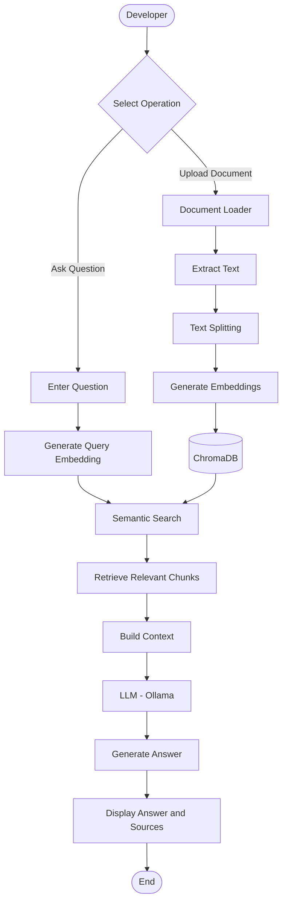
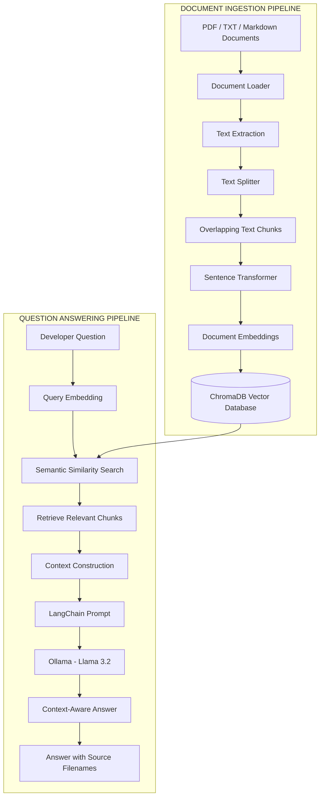

# Engineering Intelligence Hub 🚀

An AI-powered engineering knowledge assistant that helps developers search technical documents and get context-aware answers using **Retrieval-Augmented Generation (RAG)**.

---

## 📌 Overview

Engineering Intelligence Hub is designed to make engineering knowledge easier to access. It allows developers to upload engineering documents, convert their content into vector embeddings, store them in a vector database, and ask questions using natural language.

The system retrieves relevant information from uploaded documents using semantic search and uses a Large Language Model (LLM) to generate accurate, context-aware answers.

The project combines document processing, vector search, embeddings, and locally running LLMs to create an intelligent engineering knowledge assistant.

---

## ✨ Key Features

- **Document Ingestion:** Load PDF, TXT, and Markdown documents.
- **Text Chunking:** Split documents into smaller overlapping chunks.
- **Semantic Embeddings:** Generate vector embeddings using Sentence Transformers.
- **Vector Database:** Store and retrieve document embeddings using ChromaDB.
- **Semantic Search:** Retrieve relevant engineering information based on user questions.
- **AI-Powered Answers:** Generate context-aware answers using Ollama.
- **Source Awareness:** Include source filenames with retrieved information.
- **Local LLM Support:** Run language models locally using Ollama.

---

## 🛠️ Technology Stack

| Component | Technology |
|---|---|
| Programming Language | Python |
| LLM Framework | LangChain |
| Language Model | Llama 3.2 |
| Embedding Model | Sentence Transformers (all-MiniLM-L6-v2) |
| Vector Database | ChromaDB |
| LLM Runtime | Ollama |
| Document Processing | PyPDF |
| Environment Configuration | Python dotenv |

---

## 🏗️ System Architecture

The system follows a Retrieval-Augmented Generation architecture with two main workflows:

1. Document ingestion and vector storage.
2. Question processing, semantic retrieval, and answer generation.

### 1. Complete Project Workflow



### 2. RAG Architecture Diagram

This diagram explains how the document ingestion pipeline and question-answering pipeline work together.



### 3. RAG Processing Steps

| Step | Process | Description |
|---|---|---|
| 1 | Document Loading | Reads PDF, TXT, and Markdown files. |
| 2 | Text Extraction | Extracts readable content from documents. |
| 3 | Text Splitting | Divides content into overlapping chunks. |
| 4 | Embedding Generation | Converts text chunks into numerical vectors. |
| 5 | Vector Storage | Stores embeddings and metadata in ChromaDB. |
| 6 | Query Embedding | Converts the user's question into a vector. |
| 7 | Semantic Retrieval | Finds relevant document chunks. |
| 8 | Context Construction | Combines retrieved content into a prompt. |
| 9 | Answer Generation | Uses Ollama Llama 3.2 to generate an answer. |
| 10 | Source Identification | Returns associated source filenames. |

---

## 📂 Project Structure

```text
ENGINEERING-INTELLIGENCE-HUB/
│
├── app/
│   ├── api/
│   │   └── routes.py
│   │
│   ├── embeddings/
│   │   └── embedder.py
│   │
│   ├── generation/
│   │   └── answer_generator.py
│   │
│   ├── ingestion/
│   │   ├── document_loader.py
│   │   ├── pipeline.py
│   │   └── text_splitter.py
│   │
│   ├── retrieval/
│   │   └── retriever.py
│   │
│   ├── vectorstore/
│   │   └── chroma_store.py
│   │
│   ├── config.py
│   ├── engine.py
│   └── main.py
│
├── dashboard/
├── data/
├── tests/
│
├── .env.example
├── .gitignore
├── requirements.txt
└── README.md
```

---

## ⚙️ Installation and Setup

### 1. Clone the Repository

```bash
git clone https://github.com/YOUR-USERNAME/engineering-intelligence-hub.git
cd engineering-intelligence-hub
```

### 2. Create a Virtual Environment

```bash
python -m venv venv
```

Activate on Windows:

```powershell
.\venv\Scripts\Activate.ps1
```

### 3. Install Dependencies

```bash
pip install -r requirements.txt
```

### 4. Install and Configure Ollama

Install Ollama from its official website:

https://ollama.com/

Download the Llama 3.2 model:

```bash
ollama pull llama3.2
```

Make sure the Ollama service is running locally.

### 5. Configure Environment Variables

Create a `.env` file in the project root using `.env.example` as a reference.

```env
OLLAMA_BASE_URL=http://127.0.0.1:11434
OLLAMA_MODEL=llama3.2
EMBEDDING_MODEL=all-MiniLM-L6-v2
```

---

## 🚀 Usage

1. Start the application using the configured application entry point.
2. Upload an engineering document in PDF, TXT, or Markdown format.
3. The system extracts and splits the document content.
4. Text chunks are converted into embeddings and stored in ChromaDB.
5. Enter a technical question.
6. The system retrieves relevant information through semantic search.
7. Ollama generates an answer using the retrieved context.
8. View the generated answer and associated source filenames.

*The exact startup command and API examples will be documented after final application entry-point verification.*

---

## 💡 Example Use Case

**Developer Question:**

"What technologies does the engineering team use?"

**How the System Works:**

1. Converts the question into a vector embedding.
2. Searches the ChromaDB vector database.
3. Retrieves relevant engineering document chunks.
4. Passes the retrieved information to the LLM.
5. Generates a context-aware answer using the available documents.
6. Returns the answer with associated source filenames.

---

## 📊 Current Project Status

| Component | Status |
|---|---|
| Document Ingestion | Developed |
| Text Splitting | Developed |
| Embedding Generation | Developed |
| ChromaDB Integration | Developed |
| Semantic Retrieval | Developed |
| LLM Answer Generation | Developed |
| Testing and Final Validation | In Progress |
| GitHub Publication | In Progress |

---

## 🔮 Future Enhancements

- Conversation history and multi-turn question answering.
- Improved source citations and document references.
- Authentication and role-based access control.
- Advanced retrieval and reranking.
- Evaluation metrics for RAG response quality.
- Production deployment and monitoring.

---